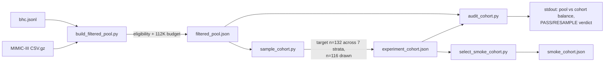
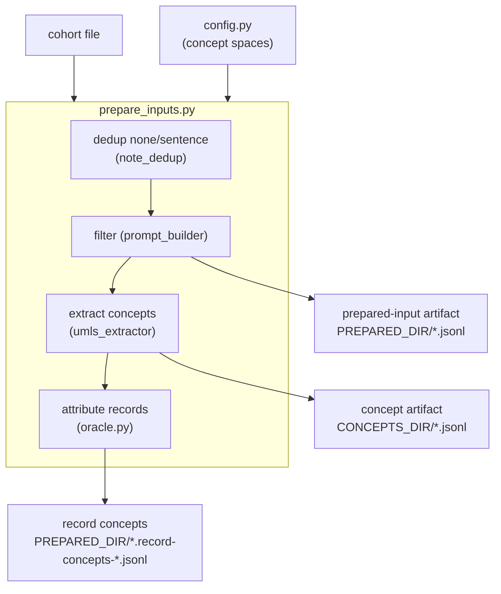
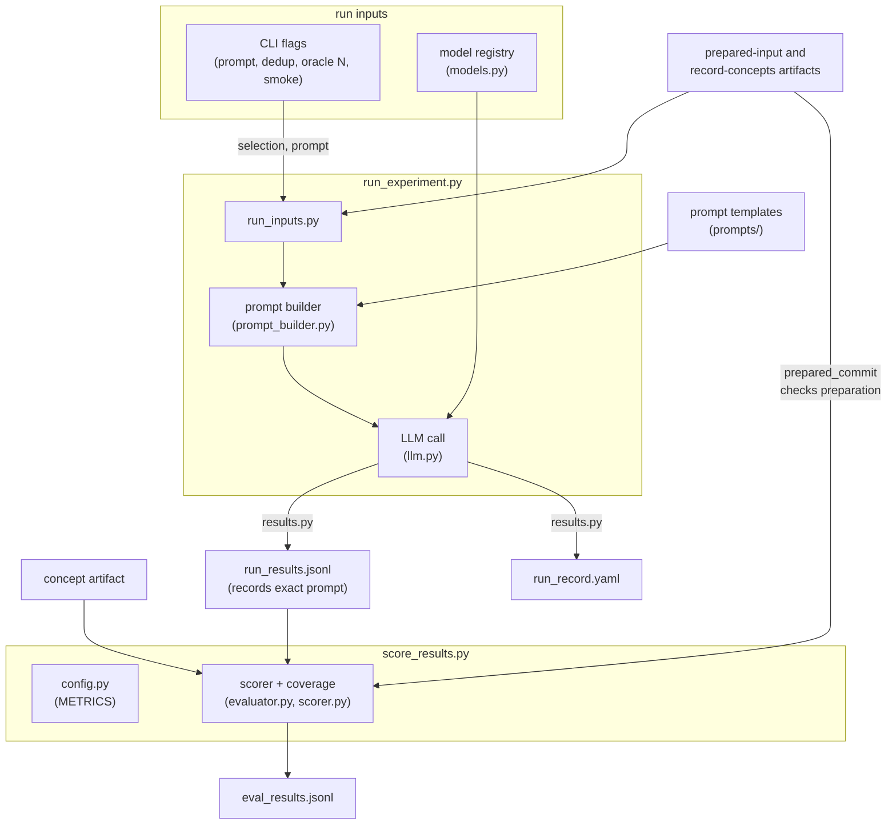
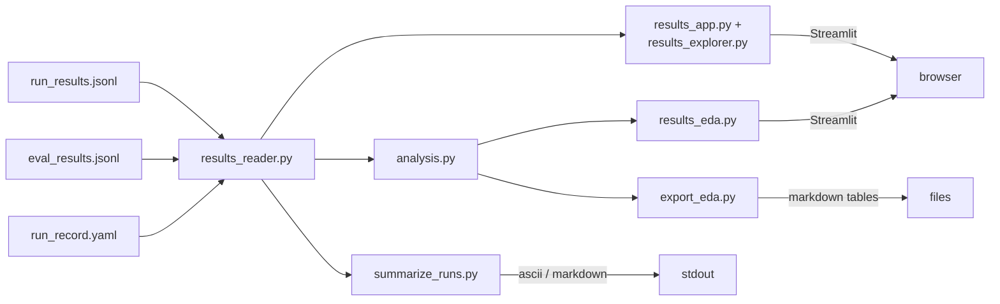

# Brief Hospital Course (BHC) generation

Experiment infrastructure for Brief Hospital Course (BHC) generation from MIMIC-III admission records.

This project uses small open-weight models (Gemma 4 E4B, Qwen3.5-4B, and Llama 3.2 3B, 4-bit quantized) for on-device BHC generation. It generates BHCs for admission ranging from 4K to 112K input tokens to test how the models perform with small and long contexts.

## Scope

The experiments compare two ways of feeding an admission to the model: all of its records, or an oracle's selection of them.

| Run | Question it answers | Input | Context and token cost |
| --- | --- | --- | --- |
| **All records** | What is each model's best quality without retrieval, and how far does long context keep paying off? | Every prepared record, in chronological order. | Every model is served with a 128K window. Highest token cost. Derives the working budget: the largest stratum a model runs within the feasibility limits. |
| **Oracle selection, radius N** | Would a perfect retriever beat feeding all records? Does adding the records around each pick (depth) beat the picks alone (breadth)? | The records that mention a reference concept (the anchors), plus the N records on each side of each anchor. Long strata (32K and up) only. | The selected records' tokens. |

All-records runs cover seven admission-size strata at 4K, 8K, 16K, 32K, 64K, 96K, and 112K, with fewer admissions in the larger strata because they take longer to run. Short admissions are rare in the pool, so the realized 4K stratum falls short of its target and the cohort has 116 admissions. Per-stratum targets are under [Stage 2](#stage-2-create-the-cohort).

The dissertation calls the all-records runs Case 0.

The experiment mechanics and the contributions are documented in the dissertation.

## Overview

The pipeline runs in order: verify prerequisites, create a cohort, prepare its inputs, spot-check the prepared data, run experiments, and view results.

Preparation (step 2) is the one place the experiment data is created from the MIMIC-III records. It filters and deduplicates the records once, in a fixed order, then extracts their concepts over that frozen text. The experiment pipeline uses the prepared data, so every experiment consumes the same data.

Preparation produces three artifacts:

- **Prepared-input artifact**: the filtered, deduplicated records (full fields) per admission.
- **Concept artifact**: UMLS concepts for each distinct text among the prepared records' raw fields and the reference BHCs, extracted once per text.
- **Record-concepts artifact**: each admission's records in chronological order, with each record's concepts and token count per model. The oracle selection reads it.

## Setup

First-time setup is one flow: prerequisites, Python dependencies, Hugging Face tokenizers, BERTScore and scispaCy/UMLS models, and the local llama.cpp server. Run it once before the Usage steps below. See [docs/setup.md](docs/setup.md).

Reproducing the experiments takes a PhysioNet credentialed account and a signed MIMIC-III Data Use Agreement. The reference MEDCON scorer also takes a UMLS Metathesaurus License.

## Usage

The workflow has two phases: build a cohort, then run experiments against it.

### 0. Verify prerequisites and run tests

Verify the external data dependencies exist to prevent hard-to-debug failures later:

```bash
ls ../mimic-iii/physionet.org/files/mimiciii/1.4/ADMISSIONS.csv.gz
ls ../phd-dissertation-experiment-results/cohorts/
```

Follow the steps to extract the BHC data in ../mimic-bhc-extraction/README.md, then verify the output:

```bash
ls -l ../mimic-bhc-extraction/bhc.jsonl
```

Run the test suite to confirm the install is working:

```bash
uv run pytest tests/ -v
```

### 1. Create the experiment cohort

Experiments need a representative subset of MIMIC-III admissions with enough clinical data and reliably extracted BHC ground truth.

Cohort creation is three stages:

1. The filtered pool has every admission passing the eligibility and token budget filters. It is the reusable record for admission-level analysis.
1. The cohort is the stratified sample drawn from the filtered pool.
1. The audit reports the per-stratum covariate balance and flags strata where any major covariate level falls below a 30% representation floor.

#### Stage 1: Build the filtered pool

The pool build applies the eligibility funnel (MetaVision, BHC quality, LOS >= 3, charting days >= 3, BHC <= 15,000 chars, safety nets). It then tokenizes each admission's record text under all three model tokenizers (Llama 3.2 3B, Qwen3.5-4B, Gemma 4 E4B) and keeps the largest of the three counts. Admissions whose max count exceeds 112K are dropped. The smallest context window across the three models is 128K. The 112K cap is 87.5% of that, leaving ~16K of headroom for the prompt template, the structured admission summary, and the BHC output.

```bash
uv run python scripts/pipeline/build_filtered_pool.py
```

The run takes several minutes, because it tokenizes every eligible admission under three tokenizers. The warnings it prints are safe to ignore.

The output is saved to the results repository at `../phd-dissertation-experiment-results/cohorts/filtered_pool.json`. This code repository must not store MIMIC data to avoid violating data privacy and usage policies.

#### Stage 2: Create the cohort

The cohort file is the single source of truth for which admissions are used in the experiment. See the [cohort sampling spec](docs/specs/experiment-cohort-sampling-design.md) for the rationale and [Codebase structure > Cohort creation](#cohort-creation) for the modules that implement this pipeline.

```bash
uv run python scripts/pipeline/sample_cohort.py
```

The output is saved to the results repository at `../phd-dissertation-experiment-results/cohorts/experiment_cohort.json`.

The sampler stratifies admissions across seven token-count strata at 4K, 8K, 16K, 32K, 64K, 96K, and 112K, then draws per-stratum (25 admissions each in the 4K, 8K, and 16K strata, 20 in 32K, 15 in 64K, 12 in 96K, and 10 in 112K). The larger strata have fewer admissions because of the quadratic cost of prefill at 96K-112K.

The token count is the maximum of the three tokenizers' counts per admission to ensure that each admission can be processed by any of the three models. The allocation rationale and per-stratum compute budget are documented in the dissertation.

Very short clinical records are rare in the filtered pool, so the 4K stratum cannot be adequately populated. The sampler logs a warning and takes all available 4K admissions in that case.

#### Stage 3: Audit the cohort

Stage 2 stratifies on token count only. Other attributes, such as BHC format and the types of notes available, are covariates (may affect generation), but are not balanced during stratification. This audit stage checks that each major level of those covariates clears a 30% representation floor in every stratum. The 30% floor is a (somewhat arbitrary) threshold to flag strata where one covariate level dominates, indicating that it doesn't match the population.

```bash
uv run python scripts/pipeline/audit_cohort.py
```

The audit prints two tables to compare the pool against the sampled cohort (filtered pool first, then cohort). A verdict line follows the tables. Any violation classified as _sampling_ (the pool cleared the floor, but the sample did not) triggers `RESAMPLE` because a different seed could plausibly clear the threshold. Anything else is `PASS`, including violations classified as _structural_ (the pool cannot clear the floor) and undersized strata, since neither can be fixed by resampling.

### 2. Prepare the frozen inputs

This step performs all data preparation, extraction, and transformation. From this point on **input data is no longer modified, just read**.

- All the admission record types used to build the prompt for the experiment.
- Deduplicated versions of the above.
- The concepts (CUIs/TUIs) extracted from the above.
- Each admission's records in chronological order, with each record's concepts and its token count under each model.

Sentence deduplication is the default. Prepare `none` as well for the deduplication comparison.

```bash
uv run python scripts/pipeline/prepare_inputs.py
uv run python scripts/pipeline/prepare_inputs.py --dedup none
```

The preparation script creates these files:

- Prepared input: `PREPARED_DIR/<cohort>-dedup-<method>.jsonl`, for example `experiment_cohort-dedup-sentence.jsonl`. One per dedup method, since deduplication changes the records.
- Concepts: `CONCEPTS_DIR/<extractor>-<config-sha>.jsonl`, for example `scispacy-b42bfe475bbb.jsonl`, where the suffix is the first 12 hex of the extractor config's SHA-256. The suffix changes with the extractor's settings and library versions, so a scispaCy upgrade gets a new file instead of reusing stale concepts.
- Record concepts: `PREPARED_DIR/<cohort>-dedup-<method>.record-concepts-<extractor>-<config-sha>.jsonl`. The oracle selects records from it. The analyses count concept mentions from it.

Preparation, generation, and scoring refuse to run on a dirty git tree and record the commit they ran at.

### 3. Spot-check the frozen inputs

This is a manual check of the cohort's data quality. The audit in Stage 3 confirms covariate balance across strata. It does not check the BHC text or the per-admission token count. The spot check covers both before the cohort feeds thousands of LLM calls. The audit reads aggregate distributions per stratum. The spot check reads one admission at a time.

#### Cohort ground truth spot check

Review per-admission BHC, token count, and day-by-category note grid.

```bash
uv run streamlit run app/spot_check.py
```

Use the app to review the 16 cases:

- 14 cases from the `(token_stratum, bhc_category)` grid: one admission per cell across seven token strata and two BHC formats.
- One extra case each at 96K and 112K. These two strata sit closest to the 112K pool budget, so the budget leaves the least headroom for prompt-size or tokenizer-count drift.

Four steps per case:

1. Read the discharge note with the BHC highlighted.
2. Check that the recorded `max_total_tokens` is plausible given the visible content. There is no checkbox for this one, so note any mismatch in the notes field.
3. Scan the day-by-category note grid.
4. Fill in the structured checklist.

The output is stored in `../phd-dissertation-experiment-results/results/spot_check_reviews.json`.

#### Deduplicated records spot check

What sentence deduplication removed and why (within/between-note duplicate sentences, surviving `ROW_ID`), read from the prepared artifact.

```bash
uv run streamlit run app/note_redundancy_review.py
```

#### Concept extraction spot check

Which UMLS concepts each prepared record and reference BHC yielded, with the matched text span and score behind every concept, read from the concept artifact.

```bash
uv run streamlit run app/concept_extraction_review.py
```

### 4. Run experiments

Generation reads the prepared records, formats the prompt, and generates, recording the exact prompt it sent per admission.

#### Smoke test

The smoke test verifies that the on-device pipeline works end-to-end (generation + scoring + analysis). Always start with the smoke test to verify the pipeline before running real experiments.

The smoke test runs one model (Gemma 4 E4B) on the smoke cohort with the unformatted prompt over all records. The smoke cohort is sized and bounded for fast on-device runs (see `select_smoke_cohort.py`), since its only job is to catch wiring errors. It is the lightest pass through the local pipeline, used before launching the heavier experiments that run all three local models.

First, create the smoke test cohort and prepare its inputs:

```bash
uv run python scripts/pipeline/select_smoke_cohort.py
uv run python scripts/pipeline/prepare_inputs.py --smoke
```

Launch llama-server with the matching alias and Gemma weights (see [Launch the server](docs/setup.md#launch-the-server)), then run generation:

```bash
scripts/setup/serve_local_llm.sh gemma_4_e4b

uv run python scripts/pipeline/run_experiment.py --model gemma_4_e4b --prompt unformatted --smoke
```

Generation writes results to the sibling `phd-dissertation-experiment-results` repo under:

```text
../phd-dissertation-experiment-results/results/
  smoke/                     # the input selection: smoke cohort, all records
    unformatted-prompt/          # the prompt variant
      gemma_4_e4b/           # the model
        run_record.yaml      # provenance, settings, and status
        run_results.jsonl    # per-admission generation results (no scores)
```

What to check: every admission in the smoke cohort completes with no errors in the log output.

Score it the same way every experiment is scored, so the smoke test exercises the same model loads, concept extraction, and coverage path. Requires the [BERTScore models](docs/setup.md#bertscore-models), the [UMLS install](docs/setup.md#umls-concept-overlap), and the [QuickUMLS setup](docs/quickumls-setup.md):

```bash
RESULTS=../phd-dissertation-experiment-results/results
uv run python scripts/pipeline/score_results.py $RESULTS/smoke/unformatted-prompt
```

Scoring adds `eval_results.jsonl` and `eval_record.yaml` alongside `run_results.jsonl` in the model directory.

What to check: the log reports the same admission count that generation produced.

Summarize the scored run as a comparison table:

```bash
uv run python scripts/pipeline/summarize_runs.py $RESULTS/smoke/unformatted-prompt
```

What to check: one row per model with non-null metric means and input/output token counts.

Open the results viewer to inspect per-admission generations against references:

```bash
uv run streamlit run app/results_app.py
```

What to check: the sidebar lists the smoke run's model, the Run Explorer page loads its summary table, and the per-admission detail view renders generated and reference BHC side by side.

#### Running across the three models

`run_experiment.py` generates for one model under one set of settings. What varies between runs is a command-line flag. Everything else is a constant in `src/bhc_experiment/config.py`.

| Flag | Values | Default |
| --- | --- | --- |
| `--model` | `gemma_4_e4b`, `qwen_3_5_4b`, `llama_3_2_3b` | required |
| `--prompt` | `brief`, `unformatted`, `thorough` | required |
| `--dedup` | `sentence`, `none` | `sentence` |
| `--oracle-n` | the oracle's neighbor radius, 0 or more | all records |
| `--smoke` | the smoke cohort | the experiment cohort |

Results are stored in the experiment data repo (`phd-dissertation-experiment-results`) as `<selection>/<prompt>-prompt/<model>`. The selection is `all-records`, `oracle-n-<N>`, or `smoke`, with `-no-dedup` appended under `--dedup none`. Rerunning resumes a partial run at the same clean commit and skips a completed one. To redo a completed run, delete its model directory. Replaced runs live in the results repo's git history.

llama-server hosts one model at a time. `run_all_models.sh` launches each model in turn and passes its flags to `run_experiment.py`:

```bash
scripts/pipeline/run_all_models.sh --prompt brief
```

To run a single model, call `run_experiment.py` directly with `--model`, as in the smoke test.

Scoring and summarization take the run directory and cover all three models. They read the run's parameters from its run record:

```bash
RESULTS=../phd-dissertation-experiment-results/results
uv run python scripts/pipeline/score_results.py $RESULTS/all-records/brief-prompt
uv run python scripts/pipeline/summarize_runs.py $RESULTS/all-records/brief-prompt
```

#### All records

Goal: Establish the long-context quality reference per model and derive each model's working budget from feasibility. Each admission's records are fed in full, in chronological order. Every model is served with a 128K context window.

Run `--prompt brief` across the three models following the [three-model run pattern](#running-across-the-three-models). This is the baseline every other run is compared against.

Then run `--prompt unformatted` and `--prompt thorough` the same way. They change the prompt and hold everything else the same to compare its effect. `unformatted` tests the format instruction and `thorough` tests the brevity instruction.

What to check: all admissions complete or fail cleanly with a recorded error. Per-admission token usage and latency are recorded.

#### Deduplication comparison

Measure whether removing duplicate note text changes quality and cost. Prepare both sets in step 2, then run and score the three models under each. The `--dedup none` run lands in `all-records-no-dedup`. Both runs cover the same admissions, so compare them per admission, paired on `hadm_id`:

```bash
uv run python scripts/pipeline/summarize_runs.py $RESULTS/all-records/brief-prompt --per-admission
uv run python scripts/pipeline/summarize_runs.py $RESULTS/all-records-no-dedup/brief-prompt --per-admission
```

Sentence dedup removes no concept by construction, so the difference is the generation effect. See the [deduplication design](docs/specs/note-dedup-design.md) for the methods and why whole-note is not in the recipe.

#### Oracle selection

An oracle retriever is a hypothetical retriever that sees the reference BHC and selects all the admission records that mention concepts in that reference (the anchors). It defines the retrieval ceiling. If even this best-possible selection cannot beat feeding all records, no real retriever can.

`--oracle-n N` feeds each admission its anchors plus the `N` records on each side of every anchor (the neighbors). `N=0` feeds the anchors alone (breadth). A larger `N` adds the records closest in time to each anchor (depth). The selection reads the record-concepts file from step 2.

Only long-stratum (32K tokens or more) admissions with at least one anchor are run. Short admissions already use less memory and are completed in seconds, so there is no benefit in applying retrieval to them.

```bash
scripts/pipeline/run_all_models.sh --prompt brief --oracle-n 0
uv run python scripts/pipeline/score_results.py $RESULTS/oracle-n-0/brief-prompt

scripts/pipeline/run_all_models.sh --prompt brief --oracle-n 2
uv run python scripts/pipeline/score_results.py $RESULTS/oracle-n-2/brief-prompt
```

Scoring measures the input-coverage ceiling over the selected records, the input the oracle model saw.

Each oracle run covers only the long strata, so compare it with the all-records run per admission, not by run means. List both runs per admission and pair the rows on `hadm_id`:

```bash
uv run python scripts/pipeline/summarize_runs.py $RESULTS/all-records/brief-prompt --per-admission
uv run python scripts/pipeline/summarize_runs.py $RESULTS/oracle-n-0/brief-prompt --per-admission
```

The retrieval-ceiling gate reads the paired difference in concept recall. Compare depth (`oracle-n-2`) with breadth (`oracle-n-0`) the same way.

#### Scoring

Scoring runs after generation, as its own pass, and always runs the metrics in `config.METRICS`: ROUGE, BERTScore, the scispaCy concept metric, and reference MEDCON. It reads the step-2 prepared-input artifact. The input-coverage ceiling also reads the concept artifact. Each pass replaces the model directory's `eval_results.jsonl`, one line per admission, and records what scored it in `eval_record.yaml`.

```bash
uv run python scripts/pipeline/score_results.py $RESULTS/all-records/brief-prompt
```

Scoring refuses two kinds of run: one whose inputs were prepared again after it was generated, and one whose stored prompts differ from the prompts the current code builds. In both cases the ceiling would describe records the model did not see. It warns on a run that did not complete.

##### Reading the reference MEDCON score

Reference MEDCON is Yim et al.'s scorer, unmodified, over its own QuickUMLS matcher. It puts one figure in the units the MEDCON literature reports. Read it as directional agreement with the scispaCy scores. Agreement is strong evidence that a conclusion does not rest on our extractor. Disagreement is ambiguous: the reference implementation divides its precision by the prediction's term count, so a model that writes longer output scores lower F1 independent of content. Check the per-model output lengths before reading a reversal as a finding.

#### Analysis commands

These reports read a scored run. See [Deriving everything else](#deriving-everything-else) for the rest of the results chapter.

`RUN` names the primary run under inspection, the all-records baseline with the brief prompt.

```bash
RESULTS=../phd-dissertation-experiment-results/results
RUN=$RESULTS/all-records/brief-prompt
```

##### Generation results

These reports summarize what a scored run produced: the score table across models, then quality, completion, and cost per stratum with confidence intervals. They back the headline quality table, the no-degradation figure, and the feasibility tables. The three `analysis` scripts write their reports and figures into the run folder (see [scripts/analysis/README.md](scripts/analysis/README.md)).

```bash
uv run python scripts/pipeline/summarize_runs.py "$RUN" # add --per-admission for one row per admission
uv run python scripts/analysis/quality.py "$RUN"
uv run python scripts/analysis/completion.py "$RUN"
uv run python scripts/analysis/cost.py "$RUN"
```

The Streamlit viewers and `export_eda.py` in step 5 read the same `eval_results.jsonl` files for side-by-side inspection.

##### Concept coverage

Concept coverage decomposes in both directions, separating the structural ceiling from model capability.

Take eight labeled concepts spread across the three sets:

- Reference BHC (ground truth): C1, C2, C3, C4, C5. C2 appears nowhere else.
- Admission records (the input): C3, C4, C5, C6, C7. C6 is not in the reference. C7 is in neither of the others.
- Generated BHC: C1, C5, C6, C8. C8 is in neither of the others.

| Quantity | Counts | Value |
| --- | --- | ---: |
| Input-coverage ceiling | C3, C4, C5 in the input, over the five in the reference | 0.60 |
| Concept recall | C1, C5 in the generation, over the five in the reference | 0.40 |
| Input utilization | recall over the ceiling, 0.40 / 0.60 | 0.67 |
| Capture | C5 generated, over C3, C4, C5 that the input supplied | 0.33 |
| Unsupported share | C8 generated, over the four generated | 0.25 |

C2 and C1 are what pull the values apart. C2 is in the reference and nowhere else, so it lowers the ceiling and no model can recover it. C1 is in the reference and the generation but not the input, so utilization counts it and capture does not. On the generated side, the four concepts cover every combination of input and reference: C5 is in both, C1 only in the reference, C6 only in the input, and C8 in neither.

##### Deriving everything else

Every score-derived number in the results chapter is arithmetic over two files that step 2 and the scoring pass already wrote.

`eval_results.jsonl` has one line per admission: its scores keyed `{name}/{submetric}`, and its input-coverage ceiling with the counts behind it. The ceiling is the one quantity that cannot be recomputed from scores alone. Join on `hadm_id` to the cohort's `token_stratum` for anything per stratum.

The concept artifact has the CUI sets, for the quantities that work on concept sets.

`src/bhc_experiment/coverage.py` has the set formulas. [docs/specs/evaluation-design.md](docs/specs/evaluation-design.md) defines the score-key contract. The dissertation's methodology chapter documents the metric configuration and how the confidence intervals were computed.

#### Outlier review

After scoring, review the odd-looking admissions: the worst N admissions by composite z-score across the primary metrics, worst first, each labeled with the metric that drove the flag.

```bash
uv run streamlit run app/outlier_review.py
```

### 5. View experiment results

**Per-admission viewer**: "How does this generation read against the reference?" Summary table of all admissions (scores, token counts, errors) plus a per-admission detail view comparing generated BHC against the reference with the full prompt available on demand.

```bash
uv run streamlit run app/results_app.py
```

**Experiment EDA**: "How do runs compare across cohort strata, models, and metrics?" Heatmap of mean score per run across all metrics, score distribution per model, per-admission scores side by side, and attribute correlation.

```bash
uv run streamlit run app/results_eda.py
```

For dissertation markdown tables from the same aggregates, use the CLI:

```bash
uv run python scripts/pipeline/export_eda.py summary "$RUN" \
    [--stratify-by <cohort_column>] --output <path>
```

## Codebase structure

The codebase follows the data lifecycle: build a cohort, prepare its inputs once, run experiments on the prepared inputs, analyze the results.

Reusable logic (data access, sampling, pipeline components) lives in packages under `src/` so it can be imported by multiple consumers and tested independently. The entry points that call those packages live in `scripts/`, each one a record of how its output was produced:

- `pipeline/` runs the experiment: cohort building, preparation, generation, scoring, summaries.
- `setup/` fetches and serves the local LLM, and checks an install before a real run: the UMLS extractor and the server's reasoning control.
- `analysis/` reports the quality, cost, and completion for an experiment run (see [scripts/analysis/README.md](scripts/analysis/README.md)).
`scripts/quickumls_bridge.py` sits outside those folders because it runs on the sibling QuickUMLS environment's interpreter, the only one that can import `quickumls`. See [docs/quickumls-setup.md](docs/quickumls-setup.md).

### Cohort creation



The funnel narrows MIMIC-III's 58,976 hospital admissions down to the sampled cohort:

| Stage | Script | Output | Admissions |
| --- | --- | --- | --- |
| MIMIC-III hospital admissions | | | 58,976 |
| MIMIC-III ICU admissions | | | 22,046 (MetaVision-only, CareVue excluded) |
| + valid BHC extraction | | | 21,402 (extraction success, >= 100 chars, no ISERROR) |
| + eligibility filters | `build_filtered_pool.py` | `cohorts/filtered_pool.json` | 15,525 before token budget (LOS >= 3, charting days >= 3, BHC <= 15,000, safety nets) |
| + 112K pool budget | `build_filtered_pool.py` | `cohorts/filtered_pool.json` | empirical (max-of-three pivot tokenizer count <= 112K, recorded in the manifest) |
| + stratified sampling | `sample_cohort.py` | `cohorts/experiment_cohort.json` | 116 drawn against an asymmetric per-stratum target of 132 across seven token-size strata (4K/8K/16K = 25 each, 32K = 20, 64K = 15, 96K = 12, 112K = 10), seed=4. Only 4K fell short, at 9 of 25 |
| + audit | `audit_cohort.py` | stdout | per-stratum covariate balance and a single PASS/RESAMPLE verdict line that names affected cells. Branch selection on a PASS with structural breaches is a human judgment per `Sampling stratification.md` |

**`src/mimic_data_prep/`** reads MIMIC and builds the cohort. `mimic.py` defines the path constants and the SQL filtering funnel. `cohort.py` loads the filtered pool as a DataFrame and reads cohort JSON into typed objects. `sampling.py` has the stratified sampler and the cohort-file writers. Scripts and the apps import from here instead of defining their own paths or cohort logic.

Each cohort file has two parts. `admissions` has one entry per admission: its hadm_id, its assigned `token_stratum`, and the recorded covariates. `metadata` has what the cohort was built from:

- sampling parameters, and the seven-stratum definition with per-stratum target and actual counts
- the tokenizer block forwarded from the pool
- the pool file path and its SHA-256, the data source SHAs, and the git commits

`cohort_size` in the metadata is the pool size. `sample_size` is the cohort's.

That second part is what lets a cohort trace back to its inputs without re-running the sampler. Cohort files live in the sibling repo `phd-dissertation-experiment-results` (see [Prerequisites](docs/setup.md#prerequisites)).

### Preparation

The stage between cohort and experiments. It writes the three artifacts every consumer reads. See [docs/specs/preparation-design.md](docs/specs/preparation-design.md) for the prepare-once rule, the artifact names, and the consumer contract.



- **`src/bhc_experiment/prepared_store.py`** is the read-only reader for the prepared-input artifact, named by cohort and dedup method. The note filter is fixed, so those two identify the file.
- **`src/bhc_experiment/concept_store.py`** and **`concepts.py`** are the concept artifact reader and the `extractor_config_sha256` fingerprint that names it.
- **`src/bhc_experiment/oracle.py`** attributes each record's concepts, writes and reads the record-concepts file, and makes the oracle selection from it.

### Experiment pipeline

**`src/bhc_experiment/`** runs the experiment pipeline. `config.py` has the settings every run shares and `CliParameters`, what varies between runs. `src/mimic_data_prep/models.py` is the model registry: everything that identifies and serves each model. `run_inputs.py` decides which admissions a run covers and the bundle each one gets, for generation and scoring alike. A run reads its admissions from the prepared store, never from the MIMIC loader, so it cannot see records that preparation dropped.



The prompt builder supports the `unformatted`, `brief`, and `thorough` prompt variants. The `unformatted` variant uses a single template with no format instruction for all admissions. The `brief` and `thorough` variants select a narrative or domain-organized template that matches each admission's ground-truth BHC format. The variant changes formatting at consumption only. The prepared record set is the same either way. See `src/bhc_experiment/prompt_builder.py` for how a template is picked, and the [prompt builder design doc](docs/specs/prompt-builder-design.md) for why the variant and the BHC format are chosen separately.

**`prompts/`** has versioned prompt template files (one per prompt variant + BHC format combination).

### Results analysis

**`src/bhc_experiment/results_reader.py`** is the shared read-path for experiment results. Score keys are whatever the metric entry named them, in the form `{name}/{submetric}` (`sapbert/f1`, `rouge1/f1`), and the reader passes them through unchanged.

**`src/bhc_experiment/analysis.py`** aggregates those per-admission rows for display. The EDA page and the export CLI both call it, so labels and aggregates cannot drift between interactive exploration and dissertation export.

**`src/bhc_experiment/reporting.py`** backs the `scripts/analysis/` reports: resolving a run onto the cohort strata, per-stratum bootstrap confidence intervals, table formatting, and figure saving. Decision-analysis scripts read runs through it too.

**`scripts/pipeline/summarize_runs.py`** produces comparison tables across the models of one run (mean scores, token counts, latency). **`scripts/pipeline/export_eda.py`** exports the same aggregates as dissertation-bound markdown tables.

**`app/`** has the Streamlit viewers, each launched from its Usage step above. The per-admission viewer spans two modules: `results_app.py` selects a model's directory, `results_explorer.py` renders it.



### Supporting files

**`tests/`** has unit tests using synthetic CSV.gz fixtures with DuckDB.

**`docs/`** has the setup instructions, the QuickUMLS setup, the cohort decision chain, and the design specs under `docs/specs/`.

See [AGENTS.md](AGENTS.md) for code style conventions and the decision document paths.

## Related repositories

This repository consumes outputs from sibling repositories but does not duplicate their code.

[**mimic-bhc-extraction**](https://github.com/fau-masters-collected-works-cgarbin/mimic-bhc-extraction) provides BHC extraction and the shared data access layer (DuckDB loading, column mapping, format detection). This repo consumes the extracted BHC text as ground truth and follows the extraction repo's patterns for loading MIMIC CSV.gz files and testing.

**mimic-admission-explorer** extends those data access patterns into a broader query framework with reusable SQL patterns for cohort profiling.

**mimic-explorer** provides pre-computed statistics, timeline queries, and the MIMIC schema reference.

**phd-dissertation-experiment-results** stores all MIMIC-derived data: cohort definitions, the prepared-input and concept artifacts (`PREPARED_DIR`, `CONCEPTS_DIR`), experiment results, and spot-check reviews. Separated from this code repo for DUA compliance. It stays local because it contains MIMIC-derived data.

## License

MIT ([LICENSE](LICENSE)). The license covers the code here. It grants nothing over MIMIC-III or the UMLS vocabularies, which carry their own agreements (see [Setup](#setup)).

This repository contains no MIMIC data, down to patient identifiers. Cohorts, artifacts, and results live in [phd-dissertation-experiment-results](https://github.com/fau-masters-collected-works-cgarbin/phd-dissertation-experiment-results).

## AI Disclosure

I used a coding agent (Claude Code with Opus) in this work. I reviewed its output and am responsible for the result.
