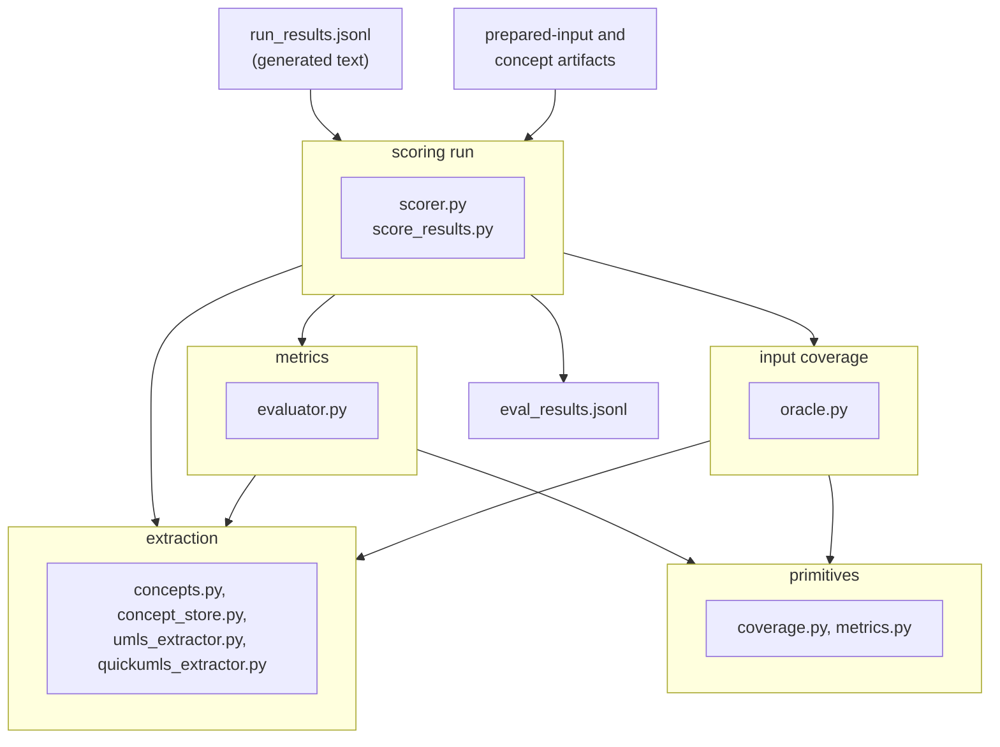

# Evaluation Design

Metric adoption decisions (what we compute, why, what is deferred) are documented in the dissertation, along with what the input-coverage ceiling measures and why.

This spec covers the architecture: the modules that turn a generated summary into scores, how they depend on each other, and the contracts between them. It ends at `eval_results.jsonl`. Reading those scores back into tables and figures is results analysis, covered by the README's [Results analysis](../../README.md#results-analysis) section.

## The layers

Each layer calls the layers below it and never the layer above.

| Layer | Modules | What puts a module here |
| --- | --- | --- |
| Scoring run | `scorer.py`, `score_results.py` | Reads a run directory and writes `eval_results.jsonl` |
| Metrics | `evaluator.py` | Implements `MetricFn`: parallel candidate and reference lists in, one score dict per pair out |
| Input coverage | `oracle.py` | Assembles an admission's input the way generation saw it, then measures the ceiling over it |
| Extraction | `concepts.py`, `concept_store.py`, `umls_extractor.py`, `quickumls_extractor.py` | Turns clinical text into CUI sets, so it needs a linker or the concept artifact |
| Primitives | `coverage.py`, `metrics.py` | Pure set formulas and key constants, with no file or model access |

`coverage.py` has the set formulas the layers above it share. `concept_prf` is what the MEDCON-style metric calls for its precision, recall, and F1. `input_coverage` and `partition_generated` serve the ceiling and the generated-concept partition, both below.

`scorer.py` has the scoring logic, so it is importable and testable. `score_results.py` is the CLI entry point.

## Why generation and scoring are separate

Generation never scores. Scoring never calls an LLM. `run_experiment.py` writes text to `run_results.jsonl`. `score_results.py` reads that file back in a second pass.

Stored generations can be scored again under a new metric with no LLM time.

Generation stays light. Scoring loads DeBERTa-XLarge and the scispaCy linker. Generation loads neither.

## Why metrics score a whole run at once

BERTScore and MEDCON have a fixed startup cost per call, so scoring a run in one call is much faster than scoring one admission at a time. ROUGE has no such cost and just loops, so it loses nothing by being called the same way.

## Score keys are a cross-module contract

A metric's name is what appears in every table and figure built from the scores, because `results_reader.py` passes score keys through unchanged. Renaming a metric renames a column in the dissertation's tables.

Keys take the form `{name}/{submetric}`. `name` is the metric entry's `name`, or the concept space's `name` for the concept metric. `submetric` is fixed by the metric implementation. A misspelled key does not raise. It selects nothing, so the column comes back all-NaN. `metrics.py` defines every key as a named constant for that reason.

## One metric set, overwritten

Every run is scored with `config.METRICS`, so a scoring pass rewrites the whole `eval_results.jsonl`, one line per admission, and records what scored it in `eval_record.yaml`. The robustness checks in other concept spaces recompute recall from concept sets instead of scoring, so they never write to the eval file.

Scoring has no checkpoint or resume. The same generated text, reference text, and metric set always produce the same score, so a crashed pass is repaired by running it again.

## The input-coverage ceiling

The ceiling is the share of the reference summary's concepts present in the assembled model input. It bounds concept recall for almost every admission. A model can still produce a concept the extractor did not find in the input, by inference or by wording that links where the raw input did not.

Two functions compute it:

- `coverage.input_coverage` is the set formula over an input CUI set and a reference CUI set.
- `oracle.admission_input_coverage` is the admission-level computation: it assembles the input through the prompt builder's own formatters and filters, extracts the concepts, and applies the formula. `score_results.py` takes this path over the bundle `run_inputs.py` gives it, so an oracle run's ceiling is over its selected records.

The admission-level function sits in `oracle.py` because it reuses the oracle's record attribution, which is what makes its candidate records match what an all-records run fed the model.

The ceiling reads the same frozen prepared-input and concept artifacts that generation reads, so the input the model saw and the input the ceiling measures are the same records by construction. `preparation-design.md` explains why.

## Not owned by this spec

- **Which metrics to compute, and why.** Documented in the dissertation.
- **The `eval_results.jsonl` layout and the model directory it sits in.** `results-storage-design.md`.
- **The prepared-input and concept artifacts the scorer reads, with their fingerprints.** `preparation-design.md`.
- **Commands.** The README's [Scoring](../../README.md#scoring) section has every invocation.
- **Why QuickUMLS runs in a subprocess.** `../quickumls-setup.md`.
- **Faithfulness.** No faithfulness instrument runs. `config.METRICS` has no faithfulness metric. Faithfulness is bounded by the unsupported share of the generated-concept partition, which `coverage.partition_generated` computes and `generated_concept_partition.py` reports. The dissertation names an LLM-as-judge design as the path that would close the gap, deferred to future work.
