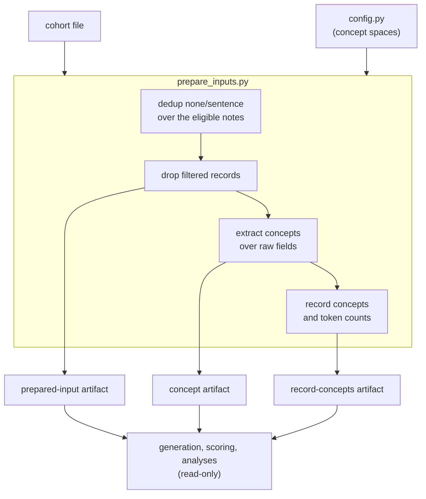

# Preparation Design

The stage between cohort and experiments. Preparation is the one place input is built: it deduplicates and filters each admission's records once, in fixed chronological order, extracts their concepts over that frozen text, then records each admission's records with their concepts and per-model token counts. All three outputs are materialized as artifacts. Every later step only reads them.

The artifact file names, the extractor fingerprint, and the per-text keying are defined in `prepared_store.py`, `concepts.py`, `concept_artifact.py`, and `oracle.py`. This spec covers why the stage exists and what depends on it.

## Why prepare once

Filtering, deduplication, and concept extraction each have details a second copy of the logic gets slightly wrong. Consumers that each filter, deduplicate, or extract on their own drift apart, then compute the same input-coverage ceiling and disagree on it. Extracting from a record's formatted prompt line where its raw field belongs is one such detail: the line's timestamps and lab flags add concepts that were never clinical content (see `concept_text` in `concepts.py`).

Preparing once and reading many removes the drift by construction. There is one filtered, deduplicated record set and one concept set per configuration, so no consumer can filter or deduplicate a second, slightly different way.

## The prepare-once rule

Preparation filters, deduplicates, orders, and freezes the records once per configuration. Formatting, tokenizing, scoring, generation, and oracle selection only read them. The consequence is the property the evaluation depends on: the input the model sees, the concepts scored against it, and the records the oracle selects from are the same records and the same concepts, in agreement by construction, with no dependence on three call sites happening to match.

Deduplication is computed over the notes the filter keeps. The filtered-out records are dropped afterward. Redundancy is therefore never measured against a note the experiment would have excluded. The surviving note set is the same either way.

## Artifact names

The prepared-input artifact is named by cohort and dedup method. The note filter is fixed, so those two settings identify the file completely. The `.meta.json` beside it records the commit preparation ran at, which pins the rest. Generation copies that commit into the run record, and scoring refuses a run whose inputs were prepared again since.

The concept artifact is named by the extractor fingerprint, a hash of the extractor's settings and library versions. The fingerprint is a lookup key: scoring and the analyses find the concept artifact through it, and a library or model upgrade produces a new file instead of reusing stale concepts. The cohort stays out of the fingerprint, so one concept artifact is shared across cohorts and dedup methods. Labs, prescriptions, and reference BHCs do not change with deduplication, so a run under a different method reuses them and extracts only the note text that method produced.

The record-concepts artifact combines both names, because its records come from one prepared-input file and its concepts from one concept artifact.

## Design decisions

**Deduplication is frozen at preparation.** Sentence deduplication reports counts that depend on the set of notes alone. Which copy survives depends on their order. Freezing the removal set at preparation means the tokens actually removed at generation come from the same source as the reported cohort savings, so the two cannot drift.

**Each admission's record concepts are frozen too.** The oracle selection and the mention-count analyses need each record's concepts in chronological order, with its token count under each model. Deriving them on demand would be cheap, but the code that formats records and the tokenizer versions can change between commits. Freezing them next to the records means an oracle run's selection and a later analysis of that run read the same values. The timing of the tokenizer pass is in the preparation log.

**The artifact records what deduplication removed.** The step-3 review app reads the removed sentences from the frozen artifact and re-runs no classifier, so whatever a reviewer signs off on is byte-for-byte what generation and scoring consume.

## Consumer contract

Generation (`run_experiment.py`) and scoring (`score_results.py`) read the prepared store, the concept store, and for oracle runs the record-concepts artifact, through `run_inputs.py`. None of them open DuckDB or call the two-phase loader on the experiment path. See `note-dedup-design.md` for the deduplication methods.

## What preparation does not do

- No generation, scoring, or retrieval. It only builds and freezes input.
- No reshaping after the freeze. A consumer that needs a different dedup method or concept space re-runs preparation under that setting, producing a new artifact under a new name.

## Related

- README "Preparation" section: the operational commands and file-name scheme.

## References

- Landi et al. 2023. Clinical text deduplication practices for efficient pretraining and improved clinical tasks. arXiv:2312.09469. The sentence-level deduplication anchor.
